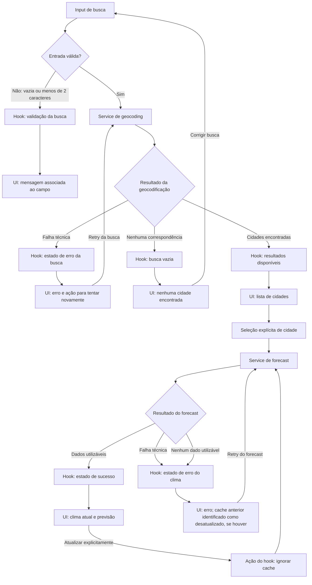

# Plano Técnico — Weather App

Este plano deriva de [weather-app-spec.md](../specs/weather-app-spec.md). O escopo
é o MVP web responsivo, sem backend, com uma cidade selecionada por vez. Os
requisitos RF/RNF e critérios de aceite citados abaixo referem-se à
especificação.

## Architecture

Aplicação SPA mobile-first organizada em quatro camadas, com dependências em um
só sentido:

```text
components/ ── interação e apresentação acessível
     │
     ▼
hooks/ ──────── estado da tela e orquestração dos casos de uso
     │
     ▼
services/ ───── rede, adaptação de respostas externas e cache
     │
     ├───────── lib/ ─ funções puras compartilhadas
     └───────── types/ ─ contratos de domínio
```

- `components/` recebe props e ações do hook; não conhece fetch, endpoints ou
  regras de cache. Componentes exibem loading, vazio, erro, dados parciais e
  dados disponíveis. Com uma cidade selecionada, a UI oferece uma ação explícita
  para atualizar o clima.
- `hooks/` coordena busca, seleção, consulta, retry, unidade e concorrência das
  operações. Ele expõe à UI estado e ações já expressos em tipos de domínio.
- `services/` é a única camada que acessa a rede. Ela valida/adapta respostas da
  Open-Meteo para o domínio e aplica as regras de cache, sem depender de React.
- `lib/` contém transformações determinísticas sem efeitos colaterais, como
  conversão de temperatura, formatação pt-BR e mapeamento de códigos WMO.
- `types/` contém os contratos compartilhados entre as camadas, sem lógica de
  apresentação ou acesso a dados.
- O fluxo de dependências evita que detalhes de UI contaminem domínio e serviços;
  a aplicação e os recursos estáticos continuam carregando mesmo quando a API
  estiver indisponível (RF-07, RF-09, RNF-04, RNF-08).

## Tech Stack

- **TypeScript strict, React e Vite:** SPA tipada, componentes e build rápido,
  conforme a stack do repositório.
- **Tailwind CSS:** layout mobile-first e tema dark glassmorphism, com contraste,
  foco visível e alvos de toque validados (RNF-01, RNF-03).
- **Open-Meteo Geocoding e Forecast:** busca e dados meteorológicos sem chave de
  API, dentro do escopo de privacidade (RF-01 a RF-04, RNF-10).
- **Vitest e Testing Library:** testes de funções, services e comportamento dos
  componentes; **Playwright:** fluxos reais nos viewports e navegadores
  especificados.
- **Biome e pnpm:** lint/formatação e gerenciamento de pacotes, seguindo o
  projeto.
- Temperaturas são mantidas em Celsius no domínio; a conversão para Fahrenheit
  ocorre somente na apresentação. Trocar unidade não inicia outra requisição.

## Project Structure

Estrutura proposta, mantendo componentes em arquivos próprios e sem adicionar
camadas de infraestrutura que o MVP não necessita:

```text
src/
├── components/
│   ├── states/
│   │   ├── LoadingState.tsx    # feedback de carregamento
│   │   ├── EmptyState.tsx      # busca sem resultados
│   │   └── ErrorState.tsx      # falha e ação de retry
│   ├── SearchBar.tsx           # entrada e envio explícito da busca
│   ├── CityResults.tsx         # resultados selecionáveis com contexto regional
│   ├── CurrentWeather.tsx      # condições atuais
│   ├── WeatherRefreshButton.tsx # atualização explícita do clima
│   ├── ForecastList.tsx        # lista responsiva de resumos diários
│   └── ForecastCard.tsx        # data, condição, temperaturas e chance de chuva
├── hooks/
│   └── useWeather.ts           # estado e coordenação do fluxo da tela
├── services/
│   ├── geocodingService.ts     # busca e adaptação de cidades
│   └── weatherService.ts       # consulta, adaptação e cache meteorológico
├── lib/
│   ├── temperature.ts          # conversão e arredondamento de temperatura
│   ├── weatherCodes.ts         # código WMO para condição em pt-BR e ícone
│   └── format.ts               # datas locais e probabilidade de chuva em pt-BR
├── types/
│   └── weather.ts              # tipos de domínio e contratos entre camadas
├── styles/                     # Tailwind e estilos globais
├── App.tsx                     # composição da tela e ligação com o hook
└── main.tsx                    # bootstrap React
```

Os componentes podem ser refinados nas Tasks, mas a direção das dependências
deve ser mantida: `components` → `hooks` → `services` → funções/contratos
compartilhados. Serviços e funções de `lib/` não importam React; `lib/` não faz
I/O. Isso permite testar transformações de forma unitária, services com fetch
mockado, hooks com services substituídos e componentes com props/ações
controladas, além de reservar E2E para validar o fluxo integrado.

## Data Model

Para desenvolver a UI, `src/types/weather.ts` também expõe `Unit`,
`ForecastDay` e `WeatherData`, equivalentes a `TemperatureUnit`, `DailyForecast`
e `WeatherSnapshot`, respectivamente. Os campos e a semântica abaixo permanecem
os mesmos. `src/mocks/weather.ts` exporta `MOCK_WEATHER`, um `WeatherData`
fictício e determinístico de Salvador, com condições atuais e cinco datas
consecutivas (29/10/2026 a 02/11/2026), sem acesso à API.

Contratos de domínio sugeridos. Respostas externas da API devem ser tratadas
como dados não confiáveis nos services e validadas antes de serem normalizadas.

```ts
type TemperatureUnit = "celsius" | "fahrenheit";

interface City {
  id: string;
  name: string;
  latitude: number;
  longitude: number;
  country?: string;
  admin1?: string;
  timezone?: string;
}

interface CurrentWeather {
  temperatureC: number | null;
  apparentTemperatureC: number | null;
  humidityPercent: number | null;
  windSpeedKmh: number | null;
  uvIndex: number | null;
  precipitationMm: number | null;
  pressureHpa: number | null; // pressão na superfície em hPa
  weatherCode: number | null;
}

interface DailyForecast {
  date: string; // YYYY-MM-DD no fuso da localidade
  temperatureMaxC: number | null;
  temperatureMinC: number | null;
  precipitationProbability: number | null; // porcentagem de 0 a 100
  weatherCode: number | null;
}

interface WeatherSnapshot {
  city: City;
  timezone: string;
  current: CurrentWeather;
  forecast: DailyForecast[];
  receivedAt: string; // instante em que o cliente recebeu a resposta
}

interface CachedWeather {
  snapshot: WeatherSnapshot;
  receivedAtMs: number;
}

type SearchState =
  | { status: "idle" }
  | { status: "loading" }
  | { status: "success"; cities: [City, ...City[]] }
  | { status: "empty" }
  | { status: "error"; error: RequestError };

type RequestError =
  | { kind: "network" }
  | { kind: "timeout" }
  | { kind: "api"; status: number }
  | { kind: "invalid-response" }
  | { kind: "unavailable" };

type WeatherState =
  | { status: "idle" }
  | { status: "loading" }
  | {
      status: "success";
      snapshot: WeatherSnapshot;
      completeness: "complete" | "partial";
    }
  | {
      status: "error";
      error: RequestError;
      stale?: { snapshot: WeatherSnapshot; ageMs: number };
    };
```

- Campos ausentes ou inválidos tornam-se `null`, nunca zero ou dado inventado.
  A UI apresenta “Indisponível” para esses campos, inclusive UV e precipitação.
- `id` identifica o resultado geográfico (usar o identificador fornecido pela
  API quando houver; senão, compor uma chave estável com coordenadas e nome).
- Previsões preservam a data local como `YYYY-MM-DD`; não converter essa data
  como instante UTC.
- `SearchState` separa `idle`, `loading`, `success`, `empty` e `error`; `empty`
  representa somente uma busca válida sem cidades. `WeatherState` usa `idle`,
  `loading`, `success` e `error`; a completude de um sucesso é explícita, e erro
  com cache anterior carrega a idade do snapshot para identificá-lo como antigo.
- Temperaturas numéricas são mantidas sem arredondamento no domínio. Converter
  °C para °F pela fórmula `(C × 9/5) + 32` (e vice-versa quando necessário) e
  arredondar ao inteiro mais próximo somente ao formatar (RF-05).

## Data Flow

### Integração implementada no App

`App` usa `useWeather` para obter `status`, `data`, `error`, `search` e `retry`.
`SearchBar` envia a consulta e fica desabilitada durante `loading`.
`idle` apresenta orientação; `empty` informa ausência de cidades; `error`
apresenta a mensagem do hook e liga `ErrorState` diretamente a `retry`.
Em `success`, `CurrentWeather` e `ForecastList` recebem os dados retornados.
`unit` permanece local no `App`, preservada entre estados e passada aos dois
componentes para conversão somente na apresentação, sem novas consultas.
O horário de recebimento é formatado no fuso retornado e a fonte é Open-Meteo.
O seletor de demonstração e o timer simulado foram removidos; `MOCK_WEATHER`
permanece apenas como fixture. Cache e persistência não foram integrados.
`main.tsx` monta a aplicação e importa `styles/index.css` com as diretivas Tailwind.

### Integração futura



1. A pessoa informa uma cidade e envia o formulário. Remover espaços externos;
   vazio ou menos de dois caracteres produz validação associada ao campo sem
   requisição (RF-01, AC-20). Não buscar enquanto digita.
2. O hook inicia geocodificação com estado de carregamento. O service chama a
   API com limite de cinco resultados, normaliza nomes e metadados regionais e
   retorna os resultados selecionáveis. Sem resultados é estado vazio, distinto
   de erro; não selecionar automaticamente uma correspondência (AC-01, AC-07,
   AC-08, AC-14).
3. Ao selecionar um resultado, o hook passa a cidade selecionada ao service
   meteorológico. O service usa as coordenadas da seleção, consulta current e
   daily, normaliza as unidades e dados ausentes e anexa o horário de
   recebimento (RF-02, RF-03, RF-04).
4. O hook publica o snapshot e a UI apresenta cidade, clima atual, os dias
   disponíveis da previsão e a procedência/horário. Datas e horários são
   formatados em pt-BR no fuso da localidade (RF-04, RF-09, RNF-07).
5. Ao trocar °C/°F, somente o estado de preferência e a apresentação mudam; os
   valores originais do snapshot permanecem e todas as temperaturas visíveis
   usam a mesma unidade.
6. Com uma cidade selecionada, a ação “Atualizar” inicia uma nova consulta sem
   reutilizar o cache. Enquanto ela ocorre, comunica carregamento; em caso de
   falha, apresenta o cache anterior identificado com sua idade, se houver.
   Repetir essa tentativa mantém o bypass de cache; somente uma resposta bem-
   sucedida substitui o snapshot armazenado. Retry de busca repete a consulta
   enviada. Não há polling nem atualização automática (RF-09, AC-16, AC-28).
7. Uma falha na consulta iniciada pela seleção oferece retry da cidade
   selecionada; o serviço reutiliza cache ainda fresco em uma seleção normal,
   mas nunca apresenta um snapshot anterior como resposta atual após falha.

## External APIs

**Geocoding — Open-Meteo Geocoding API**

Recorte implementado da T-14: `searchCities(name: string): Promise<City[]>` em
`src/services/weatherService.ts`. Consulta vazia após `trim` retorna `[]` sem
rede; o nome usa `encodeURIComponent`. Respostas HTTP não-ok geram
`WeatherServiceError` com o status; estruturas inválidas também geram esse erro.
A integração com a UI e o cancelamento externo permanecem para etapas posteriores.

- URL: `GET https://geocoding-api.open-meteo.com/v1/search`
- Parâmetros relevantes: `name` (consulta aparada), `count=5`, `language=pt` e
  `format=json`. A busca é enviada explicitamente e não promete corrigir grafia
  nem equiparar consultas com e sem acento (RF-01).
- Exemplo resumido de resposta:

  ```json
  {
    "results": [
      {
        "id": 5391959,
        "name": "San Francisco",
        "latitude": 37.7749,
        "longitude": -122.4194,
        "country": "United States",
        "country_code": "US",
        "admin1": "California",
        "timezone": "America/Los_Angeles"
      }
    ]
  }
  ```

- Mapeamento para `City`: converter `id` para string; copiar `name`,
  `latitude` e `longitude`; mapear `country`, `admin1` e `timezone` para os
  campos homônimos opcionais. Não selecionar resultado automaticamente;
  exibir contexto regional quando disponível (RF-02, RF-08).

**Clima atual e previsão — Open-Meteo Forecast API**

Recorte implementado da T-15: `getWeather(city: City, signal?: AbortSignal):
Promise<WeatherData>` em `src/services/weatherService.ts`, sem cache ou
integração com a UI. HTTP não-ok e resposta sem nenhuma medida utilizável geram
`WeatherServiceError`; blocos `current`/`daily` ausentes são normalizados como
dados vazios para preservar o bloco utilizável. Medidas ausentes ou não
numéricas tornam-se `null`, e datas diárias inválidas são omitidas. O fuso usa
o valor válido da resposta, o fuso válido da cidade ou `UTC`, nessa ordem. O
retorno contém até cinco dias válidos e `receivedAt` em ISO 8601.

- URL: `GET https://api.open-meteo.com/v1/forecast`
- Parâmetros relevantes: `latitude` e `longitude` da cidade selecionada;
  `current=temperature_2m,relative_humidity_2m,apparent_temperature,precipitation,weather_code,wind_speed_10m,uv_index,surface_pressure`;
  `daily=weather_code,temperature_2m_max,temperature_2m_min,precipitation_probability_max`;
  `temperature_unit=celsius`, `wind_speed_unit=kmh`,
  `precipitation_unit=mm`, `timezone=auto` e `forecast_days=5`.
  `current` e `daily` especificam as medidas retornadas; `timezone=auto` pede o
  fuso da localidade, e cinco dias incluem hoje e os quatro dias seguintes
  (RF-03, RF-04).
- Exemplo resumido de resposta:

  ```json
  {
    "timezone": "America/Los_Angeles",
    "current": {
      "time": "2026-10-29T08:00",
      "temperature_2m": 17.4,
      "relative_humidity_2m": 72,
      "apparent_temperature": 17.1,
      "precipitation": 0.0,
      "weather_code": 2,
      "wind_speed_10m": 11.5,
      "uv_index": 1.2,
      "surface_pressure": 1015.2
    },
    "daily": {
      "time": [
        "2026-10-29",
        "2026-10-30",
        "2026-10-31",
        "2026-11-01",
        "2026-11-02"
      ],
      "temperature_2m_max": [19.2, 20.1, 18.7, 17.9, 18.4],
      "temperature_2m_min": [13.8, 14.2, 13.5, 12.9, 13.1],
      "weather_code": [2, 3, 61, 2, 1],
      "precipitation_probability_max": [20, 40, 90, 20, 10]
    }
  }
  ```

- Mapeamento para `WeatherSnapshot`: `timezone` preenche o fuso do snapshot;
  os campos de `current` alimentam respectivamente
  `temperatureC`, `humidityPercent`, `apparentTemperatureC`,
  `precipitationMm`, `weatherCode`, `windSpeedKmh`, `uvIndex` e `pressureHpa` em
  `CurrentWeather`. Para `DailyForecast`, combinar por índice `daily.time`,
  `temperature_2m_max`, `temperature_2m_min`, `weather_code` e
  `precipitation_probability_max`, atribuindo-os a `date`, `temperatureMaxC`,
  `temperatureMinC`, `weatherCode` e `precipitationProbability`. Os arrays
  `daily` são paralelos: os valores na mesma posição pertencem ao mesmo dia.
- Validar os dados antes de normalizar. Medida ausente ou inválida vira `null`;
  datas válidas permanecem no fuso da localidade e não são recalculadas no fuso
  do navegador. Omitir dias sem data válida, exibir somente os dias válidos e
  sinalizar previsão incompleta se faltarem dias (AC-05, AC-21). Se `timezone`
  faltar ou for inválido, usar o fuso válido da cidade ou `UTC`. Traduzir
  `weather_code` WMO por função pura; código
  desconhecido não impede exibir as demais medidas.
- Não enviar localização do dispositivo nem outros dados além da consulta
  necessária (RNF-10). Respeitar os termos de uso e os limites vigentes da
  Open-Meteo (RNF-09). Não há chave ou segredo de API no cliente.

## State Management

Recorte implementado da T-20: `useWeather` em `src/hooks/useWeather.ts` expõe
`status`, `data`, `cities`, `error` (mensagem ou `null`), `query`, `search`,
`selectCity` e `retry`. Por solicitação deste incremento, `search` carrega o
clima do primeiro resultado automaticamente, em vez da seleção explícita
prevista no fluxo original. Consulta aparada com menos de dois caracteres
gera erro de validação sem rede. Sem cidades, o status é `empty`.
`retry` repete a última ação iniciada: busca completa ou seleção de cidade.
Cada ação limpa dados/erro anteriores; busca também limpa a lista de cidades,
enquanto seleção preserva a lista e a consulta. IDs sequenciais invalidam
respostas antigas e operações pendentes após desmontagem. Os services ainda
não expõem cancelamento externo. O hook é consumido pelo `App`, sem cache,
persistência ou estados separados para busca e clima.

- Manter a consulta digitada, resultados e `SearchState`, cidade selecionada e
  `WeatherState` no hook `useWeather`, que coordena a tela; componentes recebem
  dados, preferências e ações por props. Não adicionar store global nem backend.
  A tela inicia em `idle`; envio válido muda a busca para `loading`, depois para
  `success` (lista não vazia), `empty` ou `error`. Selecionar cidade inicia a
  consulta do clima em `loading`, que termina em `success` ou `error`.
- `empty` é exclusivo da busca sem correspondências. Um snapshot utilizável com
  campos ou dias ausentes continua em `success` com `completeness: "partial"`;
  indisponibilidade total de dados utilizáveis é `error`, não um falso sucesso
  nem um estado vazio.
- Persistir apenas a unidade de temperatura em `localStorage`. Validar o valor
  lido; em ausência, valor inválido ou armazenamento inacessível, iniciar em
  Celsius e manter a aplicação funcional (RF-06, AC-11, AC-12).
- O snapshot e o cache guardam temperaturas canônicas em °C, sem arredondamento.
  A renderização deriva cada temperatura exibida da preferência atual:
  `°C → °F: (C × 9/5) + 32`; em Celsius, usa o valor original. Arredondar ao
  inteiro mais próximo somente na formatação e escolher o rótulo °C/°F a partir
  da mesma preferência, para manter todos os componentes consistentes (RF-05).
  Alternar ou carregar a preferência apenas provoca nova renderização; não
  altera snapshot/cache nem inicia request.
- Manter em memória o último snapshot válido por localidade, indexado por
  coordenadas normalizadas. Considerar a resposta fresca por 10 minutos e
  reutilizá-la em seleção normal dentro desse prazo; não descartar o último
  snapshot ao expirar esse TTL, pois ele pode ser apresentado como anterior se
  uma nova consulta falhar. Atualização explícita sempre consulta a API e
  substitui o snapshot em caso de sucesso. O retry de uma atualização explícita
  também ignora o cache, para não converter uma falha de rede em falso sucesso
  com dados anteriores (RF-09, RNF-08, RNF-09). Persistência do cache entre
  recargas não é necessária ao MVP.
- Proteger busca e consulta contra concorrência: abortar a requisição anterior
  quando possível e validar um identificador sequencial antes de atualizar
  estado. Resposta tardia ou obsoleta não substitui resultado mais recente
  (AC-22, AC-29).

## Error Handling

- **Validação de busca:** mensagem pt-BR ligada ao campo; não iniciar rede para
  entrada vazia ou menor que dois caracteres.
- **Vazio:** busca válida sem correspondências informa “Nenhuma cidade
  encontrada”, sugere revisar grafia/região e permite corrigir a busca; não é
  erro técnico.
- **Carregamento:** feedback visual após ação de busca/consulta, com anúncio
  acessível. Não deixar a UI em carregamento após conclusão ou falha.
- **Rede:** classificar falha de transporte/offline como `network`; mostrar
  mensagem clara e “Tentar novamente”, sem expor detalhes técnicos. Sem cache
  válido, não apresentar dados como atuais. Com cache anterior, manter `error`
  e incluir o snapshot, horário de recebimento e idade transcorrida, claramente
  identificado como desatualizado.
- **API/resposta inválida:** validar status HTTP e formato/conteúdo antes de
  normalizar. Representar falha HTTP como `api` (identificar HTTP 429 como limite
  de consultas quando recebido); JSON malformado ou estrutura incompatível como
  `invalid-response`. Informar indisponibilidade e oferecer retry; aplicar a
  mesma regra de apresentação de cache antigo, sem transformar erro em sucesso.
- **Timeout:** limitar geocodificação e previsão a 10 segundos com abort; mapear
  expiração para `timeout`, apresentar “A consulta demorou mais que o esperado”
  e oferecer retry. Diferenciar abort intencional por request obsoleta de timeout:
  o primeiro não publica erro. Ignorar qualquer resposta tardia.
  Recorte implementado das T-17/T-18: ambas as consultas usam o helper interno
  `fetchWithTimeout` com `AbortController` e limite de 10 segundos para o `fetch`.
  `AbortError` gera `WeatherServiceError("A requisição demorou demais.")` e
  falhas de rede geram `WeatherServiceError("Falha de rede.")`. O timer é
  limpo no `finally`, tanto em sucesso quanto em falha. O cancelamento externo
  ainda não é exposto pelas assinaturas dos services.
- **Resposta parcial:** validar campos individualmente; valores ausentes ou
  inválidos ficam `null` e são exibidos como “Indisponível”. Se existir ao menos
  um dado meteorológico utilizável, publicar `success` com `completeness:
  "partial"` quando campos ou dias estiverem ausentes; exibir os dias válidos e
  avisar se houver menos de cinco. Se nenhum dado meteorológico for utilizável,
  publicar `error` (`unavailable`) e oferecer retry, sem inventar valores ou
  dias.
- Erros de leitura/escrita de `localStorage` não bloqueiam consultas; a unidade
  volta ao padrão °C quando a preferência não pode ser lida.
- Mensagens, datas e números são apresentados em pt-BR. Estados de erro, vazio e
  carregamento são semanticamente identificáveis e acessíveis por teclado.

## Testing Strategy

### Vitest — funções puras, services e componentes

- **Funções puras (RF-01, RF-03 a RF-05, RNF-07):**
  - validar consultas vazias, espaços externos, limite de dois caracteres,
    acentos e caracteres especiais; limitar os resultados a cinco;
  - verificar a conversão °C → °F com casos conhecidos (0 → 32, 100 → 212,
    −40 → −40), negativos e frações. Alternar °C/°F repetidamente deve derivar
    do mesmo valor original, sem acumular arredondamento; arredondar apenas na
    apresentação. Não criar conversão inversa apenas para testes: o domínio
    permanece em Celsius;
  - cobrir códigos WMO conhecidos/desconhecidos, números e datas em pt-BR,
    virada do dia no fuso da cidade e janela do dia atual até quatro dias depois;
  - normalizar respostas completas, parciais e inválidas: preservar zero como
    dado válido, distinguir ausência de valor e nunca inventar campos ou dias.
- **Services com mock de `fetch` (RF-01 a RF-04, RF-07, RF-09, RNF-04, RNF-09):**
  - conferir URL, parâmetros, codificação da consulta, coordenadas, unidades,
    fuso e sinal de cancelamento nos dois endpoints;
  - simular sucesso, geocodificação sem resultados, rejeição de rede, HTTP
    não-2xx (incluindo 429), JSON malformado e estrutura incompatível;
  - distinguir resposta meteorológica parcial utilizável de ausência total de
    dados: a primeira resulta em sucesso parcial; a segunda, em erro;
  - usar relógio controlado para TTL imediatamente antes, no limite e após
    10 minutos; verificar reutilização por localidade, isolamento entre cidades
    e bypass por atualização explícita;
  - testar timeout de 10 segundos com aborto, cancelamento intencional sem erro
    visível e descarte de resposta obsoleta, inclusive se o transporte ignorar
    o aborto. Cobrir a coordenação desses casos no hook, não só no service;
  - em falha, verificar que cache anterior mantém estado de erro, timestamp e
    idade explícita; sem cache, nenhum dado fictício deve ser apresentado.
- **Componentes e hooks com Testing Library (RF-01 a RF-09, RNF-03):**
  - `idle`: campo rotulado e envio explícito por botão/Enter; entrada inválida
    informa o problema sem chamar a rede;
  - `loading`: feedback acessível durante busca e consulta do clima, removido
    ao concluir ou falhar;
  - `empty`: mensagem de nenhuma cidade encontrada e possibilidade de corrigir
    a consulta; não usar esse estado para falha meteorológica;
  - `error`: mensagem compreensível e retry que repete a operação correta;
    cache antigo, se houver, identificado como desatualizado e com idade;
  - ação “Atualizar” acessível apenas com uma cidade selecionada; confirmar
    carregamento, bypass de cache e retry que mantém o bypass após falha;
  - `success`: resultados com região/país, seleção explícita, clima atual,
    cinco dias, fonte e horário de recebimento; campos ausentes exibem
    “Indisponível” e previsão parcial não cria dias fictícios;
  - troca de unidade consistente em todas as temperaturas, sem novo `fetch`;
    persistência e leitura de preferência ausente, inválida ou armazenamento
    inacessível, mantendo Celsius e a consulta funcional nesses últimos casos.

Usar fixtures pequenas e determinísticas, sem rede real. Restaurar mocks,
relógios e armazenamento entre testes. Priorizar consultas por role/nome
acessível e interações de usuário; não acoplar os testes a classes Tailwind,
estado interno ou snapshots extensos.

### Playwright — fluxos integrados e viewport mobile

Executar a aplicação no navegador com seus services reais e interceptar os
endpoints Open-Meteo com fixtures; não substituir os hooks. Assim, os E2E
validam a integração UI → service → estado → UI sem depender da disponibilidade
da API. Cobrir:

1. **Fluxo principal (RF-01 a RF-04, RF-08, RF-09):** buscar, distinguir cidades
   homônimas, selecionar e verificar cidade, condição, métricas atuais, cinco
   datas consecutivas, fonte e horário de recebimento.
2. **Recuperação (RF-07, RNF-04):** busca sem resultados seguida de correção;
   erro de busca e de previsão seguido de retry bem-sucedido; timeout sem
   loading permanente; resposta parcial com indisponibilidade explícita.
3. **Concorrência e atualidade (RF-09, RNF-09):** selecionar outra cidade com
   request pendente e entregar respostas fora de ordem; somente a seleção
   atual deve aparecer. Confirmar cache fresco sem chamada adicional,
   atualização explícita com chamada mesmo havendo cache fresco, falha exibindo
   cache antigo com idade e retry da atualização também fazendo nova chamada;
   uma atualização bem-sucedida substitui os dados e o horário recebidos.
4. **Preferência (RF-05, RF-06):** alternar todas as temperaturas sem chamada
   adicional e recarregar a página para confirmar a unidade persistida.
5. **Mobile e desktop (RNF-01, RNF-03):** executar o fluxo principal em
   360 × 800 com toque e em 1280 × 800; verificar os estados loading, erro,
   vazio e sucesso sem rolagem horizontal, controles sem sobreposição e
   alvos interativos com bounding box de pelo menos 44 × 44 px. Validar também
   navegação por teclado, foco visível e anúncios de estado; complementar
   verificações automatizadas com revisão manual de contraste WCAG 2.1 AA e
   leitura por tecnologia assistiva.
6. **Compatibilidade (RNF-05):** executar nos engines Chromium, Firefox e
   WebKit, incluindo emulação mobile. Emulação não comprova Safari/iOS ou
   Chrome/Android reais; complementar com smoke tests nesses ambientes e nos
   canais estáveis de Chrome e Edge para cumprir a matriz da spec.

Concentrar combinações e limites no Vitest; manter no Playwright fluxos de
integração representativos, sem repetir toda a matriz unitária. Usar espera por
condições observáveis e relógio controlado para TTL/timeout, sem pausas fixas.
Mocks não garantem compatibilidade futura com o provedor; quando necessário,
fazer smoke de contrato separado e não bloqueante com a Open-Meteo real, sem
tornar o aceite ou a suíte determinística dependentes da rede.

### Performance e aceite

- **Performance e aceite:** em build de produção, viewport 360 × 800, rede 4G e
  cache frio, realizar dez medições e verificar p75 LCP < 2,5 s, p75 TTI < 3 s
  e bundle inicial gzip ≤ 200 KB. Confirmar feedback visual em até 100 ms e
  validar em teste de usabilidade que o fluxo principal mobile permite
  identificar cidade, temperatura e condição em até 15 s (RNF-02, RNF-11).

## Risks & Trade-offs

| Risco da spec | Decisão/mitigação técnica | Trade-off |
| --- | --- | --- |
| Instabilidade da API (R-01) | SPA independente da rede, estados claros, retry e cache anterior com idade explícita. | O cache em memória não sobrevive a recarga; não é uma experiência offline completa. |
| Limites da API gratuita (R-02) | Busca explícita, no máximo cinco resultados, TTL de 10 min, atualização somente sob ação e descarte de requests obsoletas. | A informação pode ter até 10 min; a atualização explícita pode aumentar chamadas. |
| Cidades homônimas (R-03) | Mostrar país/região disponíveis e exigir seleção explícita antes da previsão. | A desambiguação depende dos metadados que a API fornece. |
| Expectativa de atualidade (R-05) | Separar recebimento do cliente da hora de observação; identificar fonte, timestamp e idade de cache. | O horário de recebimento não representa a precisão/idade de origem dos dados meteorológicos. |
| Contraste do tema (R-06) | Medir contraste e validar foco, teclado e leitura manual/automatizada. | O glassmorphism pode exigir ajustes visuais para atender WCAG 2.1 AA. |
| Interpretação ou expansão de escopo (R-04) | Manter explicitamente os limites do MVP e rastrear decisões aos RF/RNF. | Recursos fora de escopo exigem revisão da spec, não inclusão incidental no plano. |

### Principais decisões e alternativas consideradas

| Decisão | Benefício e custo assumido | Alternativa considerada e motivo de não adoção no MVP |
| --- | --- | --- |
| SPA React + Vite, sem backend (RNF-06, RNF-10) | Deploy simples e nenhuma credencial; o navegador depende de CORS e da disponibilidade da Open-Meteo. | SSR ou backend proxy adicionariam operação e infraestrutura sem necessidade atual de segredo, autenticação ou renderização no servidor. |
| Estado em hooks e props, services separados (RF-01 a RF-09) | Fluxo explícito e testável com poucas dependências; cache, concorrência e retry precisam de implementação e testes próprios. | Redux ou TanStack Query ajudariam com estado compartilhado/cache mais complexo, mas ampliariam conceitos e dependências para uma única tela. Reavaliar se o escopo crescer. |
| Busca por envio explícito, sem autocomplete (RF-01, RNF-09) | Menos chamadas e desambiguação deliberada; exige envio e seleção pela pessoa usuária. | Autocomplete com debounce pode acelerar descoberta, mas aumenta chamadas e concorrência e não corresponde à interação definida na spec. |
| Cache em memória por 10 minutos, sem polling (RF-09, RNF-09) | Reduz tráfego e permite fallback identificado; perde dados ao recarregar e pode mostrar informação anterior. | Cache persistido/service worker e polling melhorariam continuidade ou atualização, mas adicionariam invalidação, armazenamento e escopo offline não exigido. |
| Celsius canônico e conversão na apresentação (RF-05, RF-06) | Troca instantânea sem rede e sem perda cumulativa; todas as temperaturas precisam usar o mesmo formatador. | Solicitar Fahrenheit à API duplicaria requests/chaves de cache; guardar ambas as unidades criaria redundância e risco de inconsistência. |
| Validação na fronteira e sucesso parcial explícito (RF-03, RF-04, RF-07) | Preserva dados úteis sem esconder ausências; exige normalização e regras claras para distinguir parcial de inválido. | Rejeitar toda resposta incompleta simplificaria o fluxo, mas ocultaria dados utilizáveis; confiar apenas nos tipos TypeScript não valida JSON em runtime. |
| Tailwind e dark glassmorphism (RNF-01, RNF-03) | Segue o visual previsto com CSS enxuto; transparência pode prejudicar contraste e desempenho. | Tema opaco ou biblioteca de componentes simplificariam parte da acessibilidade; ajustar opacidade/efeitos quando necessário em vez de sacrificar WCAG para manter o efeito. |
| Vitest amplo e E2E seletivo com rede interceptada (RNF-04, RNF-05) | Feedback rápido e falhas reproduzíveis; fixtures podem divergir da API e emulação não substitui dispositivo real. | E2E exclusivamente com API real seria mais fiel, porém instável e sujeito a limites; complementar mocks com smoke de contrato e validação em dispositivos reais, sem tornar a suíte dependente da rede. |

O plano não inclui autenticação, backend, geolocalização automática, favoritos,
histórico, comparação de cidades, previsão horária, alternância de unidade do
vento, analytics ou modo offline completo, conforme o escopo da spec.
